# 03:33 — 심야 편의점

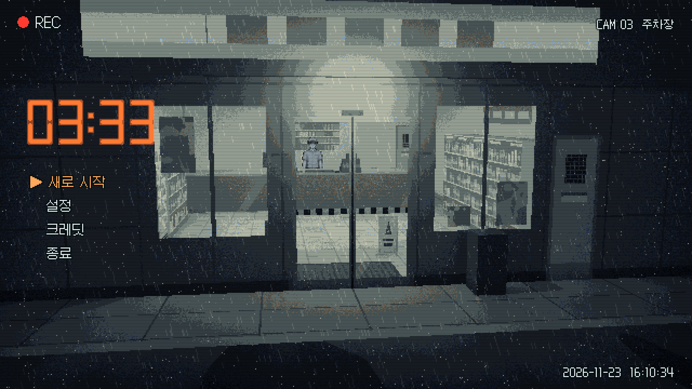

비 오는 밤, 24시 편의점 야간 알바로 7일을 버티는 2D 픽셀 공포 게임입니다.
계산대에 온 손님이 **정상인지 아닌지** 영수증과 CCTV를 보고 가려내야 합니다.
그리고 매일 밤 **새벽 3시 33분**에는, 무엇이 오든 절대 "정상"으로 마감하면 안 됩니다.

- 엔진: Unity 6000.3.25f1 (URP 2D)
- 언어: 한국어 / English / 简体中文

## 게임 흐름

### 1. 오프닝

휴대폰의 구인 공고를 보고 점장에게 전화를 겁니다. 그리고 1인칭으로 가게에 들어갑니다.

| | |
|:---:|:---:|
| 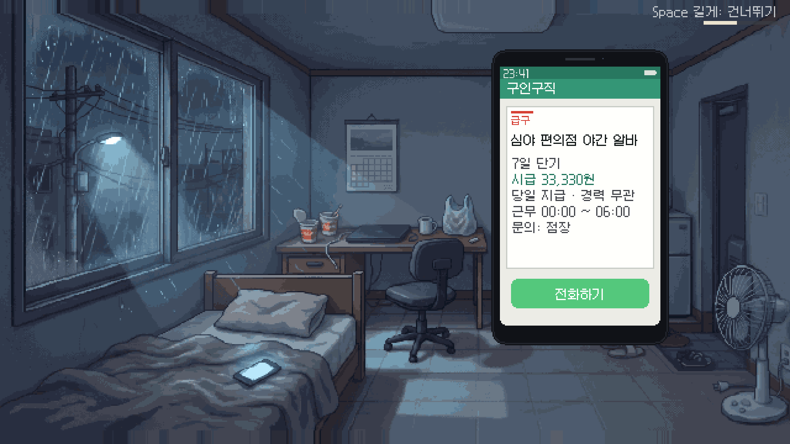 | 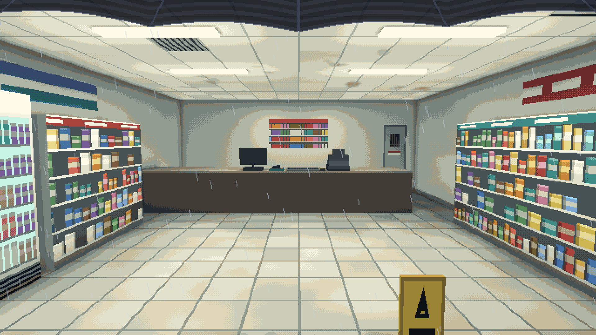 |
| 비 오는 밤, 휴대폰에 뜬 구인 공고 | 1인칭으로 가게에 들어가기 |

### 2. 근무(00:00 ~ 06:00)

근무를 시작하면 점장이 전화로 오늘의 수칙을 알려 줍니다. 수칙은 수첩에 적힙니다. 그다음 손님 10명을 계산합니다.

- 물건을 스캔하고, 영수증과 CCTV를 확인합니다.
- 점검표에 **예 / 아니오**로 판정하고 거래를 끝냅니다.
- 이상한 손님을 통과시키면 가게에 **흔적**이 쌓입니다. 평범한 손님을 의심해 내보내면 **실종자**가 생깁니다.

| | |
|:---:|:---:|
| 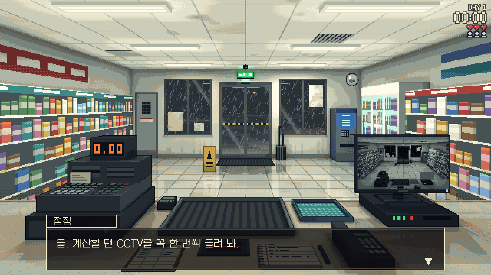 | 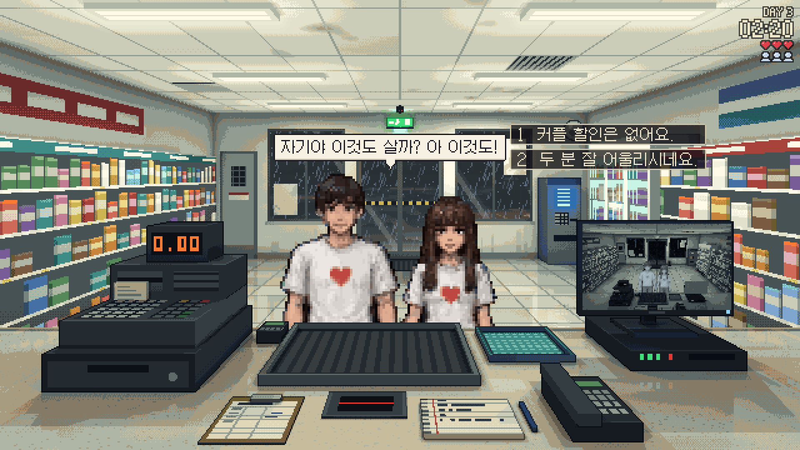 |
| 근무 시작 전 점장의 전화 | 손님의 말에 대답 고르기 |
| 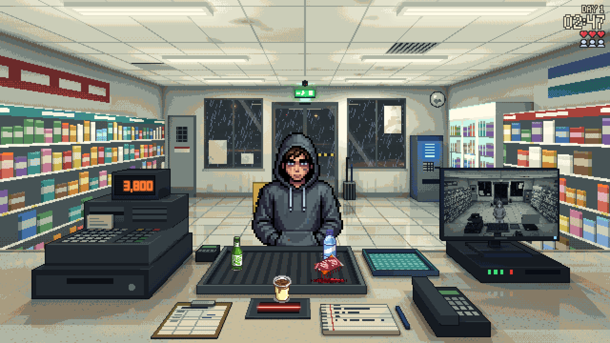 | 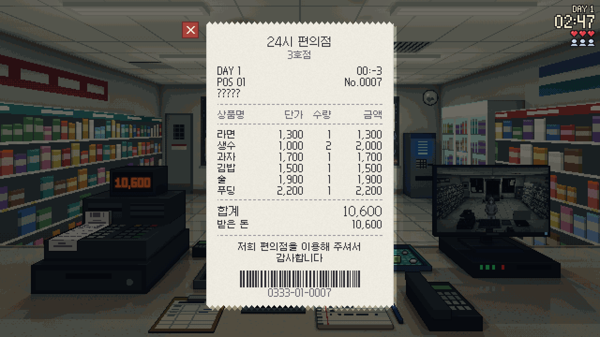 |
| 물건을 끌어내려 스캔 | 영수증 확인: 손님 설명이 깨지고 시각이 이상하다 |
| 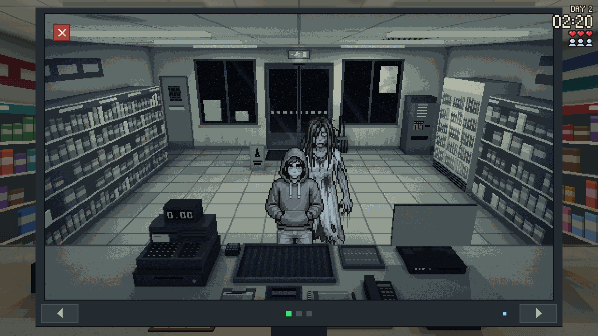 | 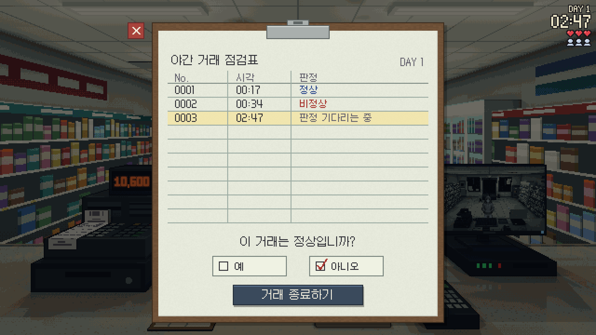 |
| CCTV에만 찍힌 것 | 점검표에 판정하고 거래 끝내기 |
| 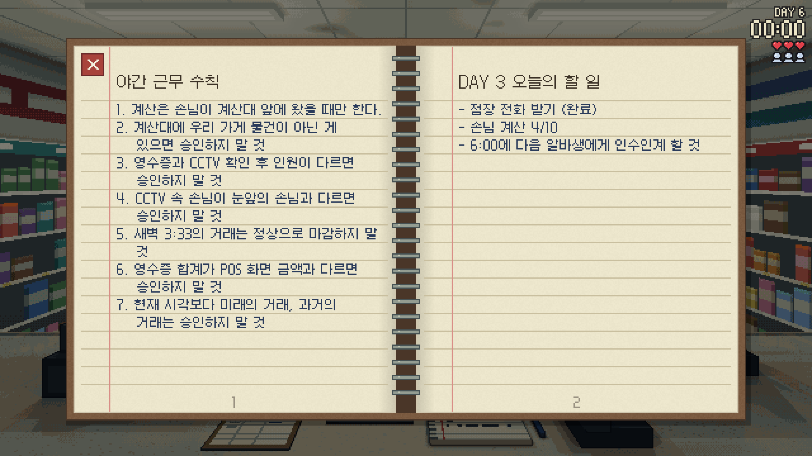 | 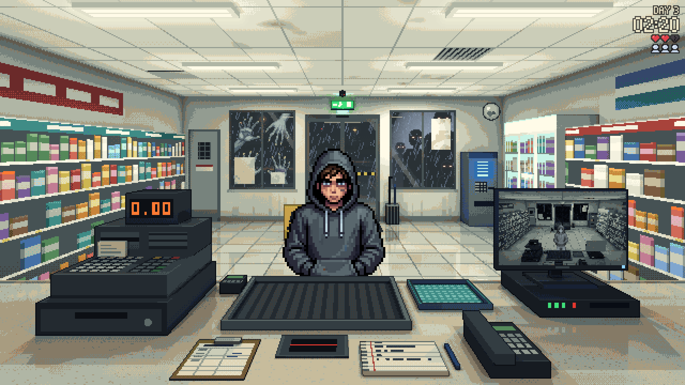 |
| 점장에게 들은 수칙이 쌓이는 수첩 | 이상한 손님을 통과시키면 남는 흔적 |

### 3. 새벽 3시 33분

밤마다 20가지 사건 중 하나가 일어납니다. 이때의 거래는 무조건 "아니오"로 끝내야 합니다.

| | |
|:---:|:---:|
| 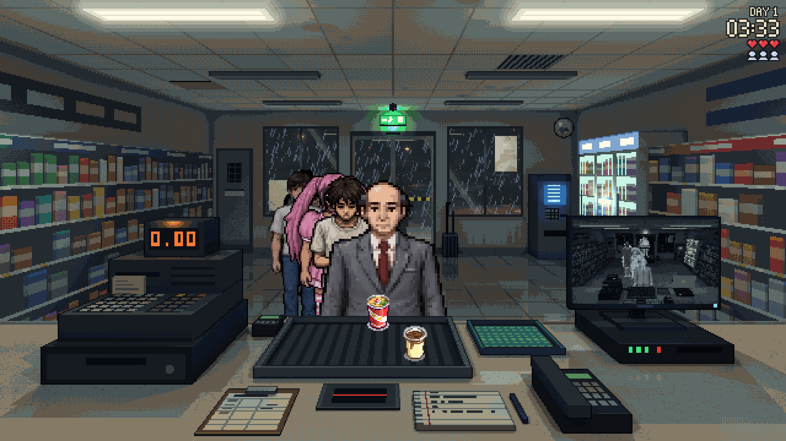 | 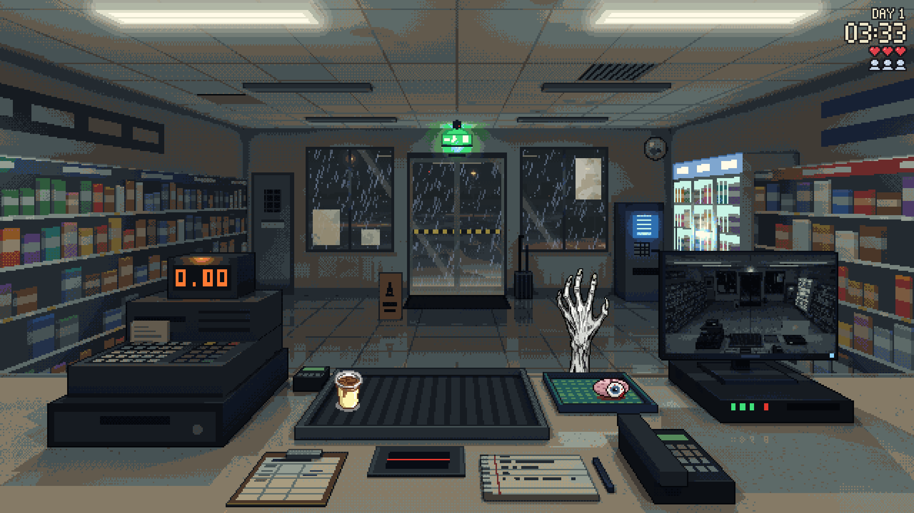 |
| 어두운 가게에 줄 선 사람들 | 계산대 밑에서 올라온 손 |

### 4. 06:00 교대

아침 알바생과 교대하고 그날의 결과를 확인합니다.

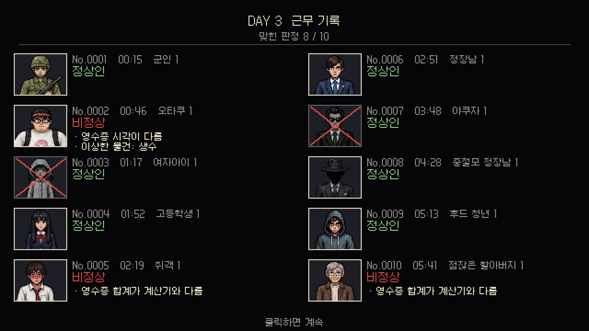

### 5. 버티기

**7일째 아침까지 버티면 엔딩**입니다. 흔적이 3개 쌓이면 죽고, 실종자가 3명이 되면 체포됩니다. 그러면 DAY 1부터 다시 시작합니다.

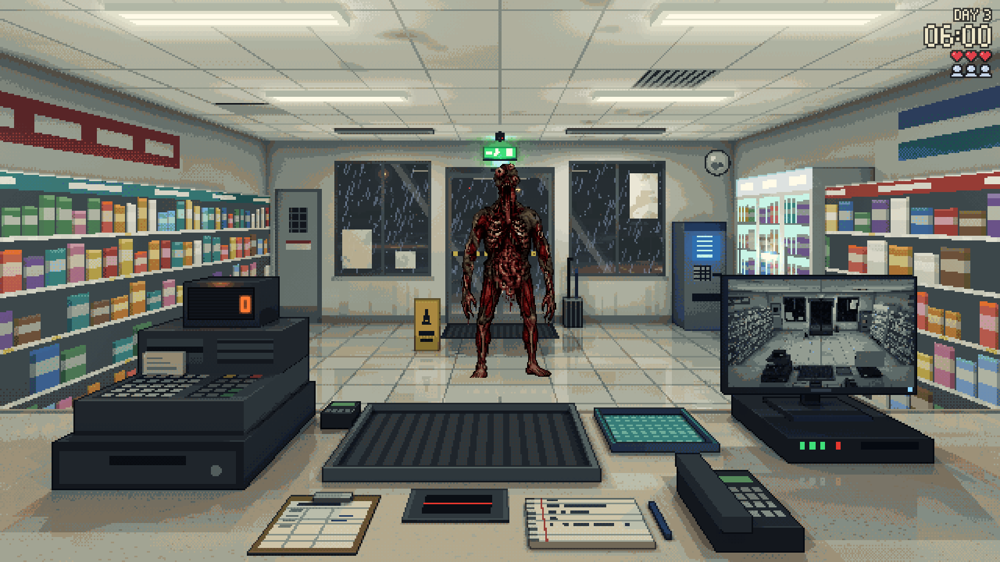

### 이상현상(점장이 알려 준 날부터 나옵니다)

| 날 | 확인할 것 |
|---|---|
| DAY 1 | 계산대 위 물건, CCTV(손님이 안 찍힘·다르게 찍힘·뒤에 무언가) |
| DAY 2 | 영수증 합계와 POS 화면 금액 |
| DAY 3 | 영수증 시각 |
| DAY 4 | 영수증의 손님 설명, 영수증 번호 |
| DAY 5 | 없는 상품, 돈 대신 내미는 것, 피 묻은 영수증 |

## 조작

| 키 | 하는 일 |
|---|---|
| 마우스 | 둘러보기 |
| 왼쪽 클릭 | 조준한 것 열기(영수증·점검표·CCTV·수첩·전화), 버튼 누르기 |
| 끌어내리기 | 물건을 스캐너로 끌어서 스캔 |
| 1 / 2 | 손님에게 할 대답 고르기 |
| Space · Enter | 대사 넘기기, 고르기 |
| Space 길게 | 오프닝 건너뛰기 |
| ← → (A / D) | 수첩 넘기기, 설정 값 바꾸기 |
| ↑ ↓ (W / S) | 메뉴 고르기 |
| Esc · 오른쪽 클릭 | 열린 창 닫기 / 일시정지 메뉴 |

## 설정

설정은 메인 화면과 일시정지 메뉴에서 같은 값을 씁니다.

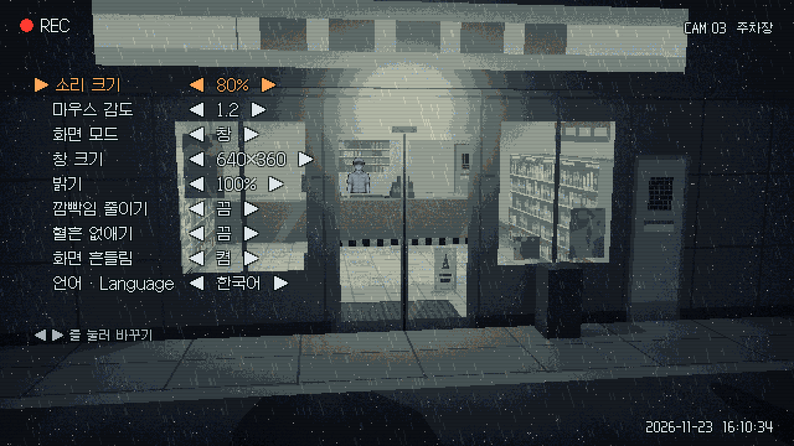

- 소리 크기, 마우스 감도
- 화면 모드(창 / 전체 화면), 창 크기(640×360의 정수배)
- 밝기(50 ~ 150%)
- 깜빡임 줄이기: 형광등 깜빡임과 번쩍임을 부드럽게 합니다
- 혈흔 없애기: 피 자국을 숨깁니다. 판정에 쓰는 피는 검은 얼룩으로 바뀝니다
- 화면 흔들림 켜기 / 끄기
- 언어(한국어 / English / 简体中文)

| | |
|:---:|:---:|
| 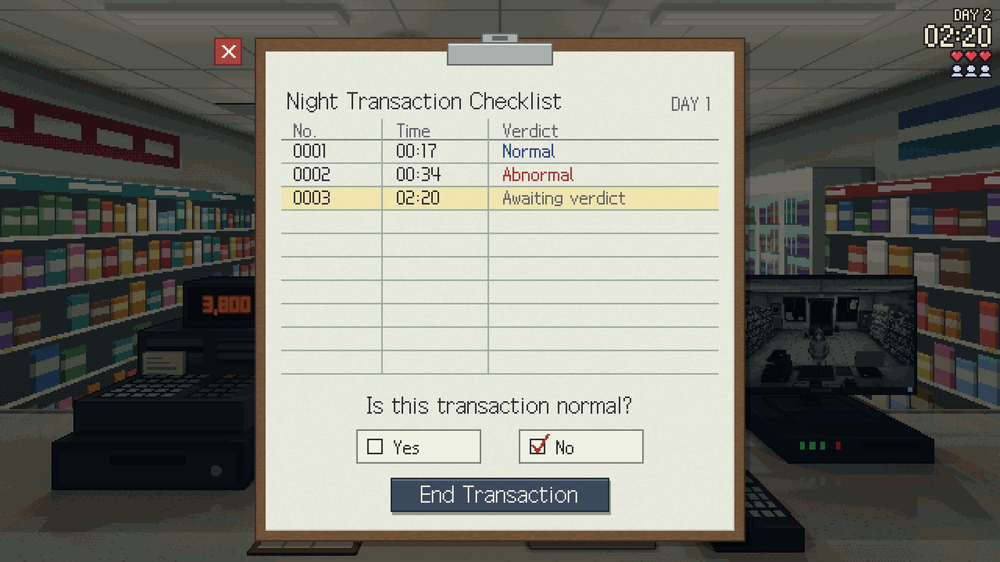 | 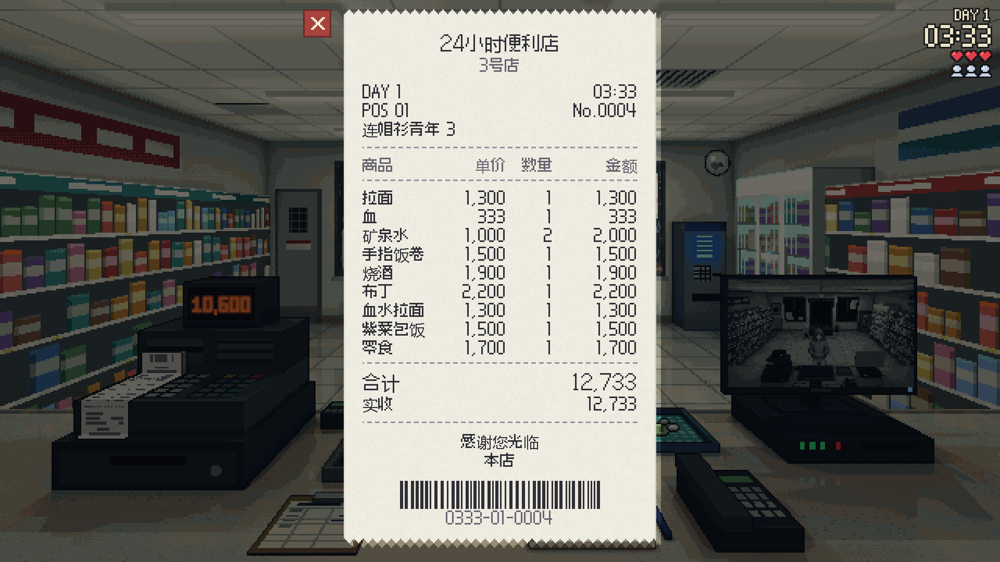 |
| English | 简体中文 |

## 프로젝트 열기

1. Unity Hub에서 **Unity 6000.3.25f1**로 이 폴더를 엽니다. `Library` 폴더는 저장소에 없고, 처음 열 때 자동으로 만들어집니다.
2. `Assets/_0333/Scenes/Store.unity`를 열고 Play를 누릅니다.
3. 장면이 깨져 보이면 메뉴 **0333 → 계산대 다시 만들기 (Rebuild Checkout)** 로 다시 만듭니다.

에디터에서만 쓰는 시험용 키: **F3**을 누르면 시계가 03:32로 건너뜁니다.

### 폴더

```
Assets/_0333/
  Scripts/    게임 코드(Checkout 계산대, Event3333 3:33 사건, Core 메뉴·설정·언어 등)
  Editor/     장면·그림을 만드는 빌더(0333 메뉴)
  Data/       대사 파일(Dialogue·PhoneCalls·Event3333·Story·Notebook·Credits)
              언어별: 이름.en.txt / 이름.zh.txt, 화면 글자: Lang/Strings.txt
  Art/        게임에 쓰는 그림
  Audio/      소리
  Fonts/      갈무리, 퓨전 픽셀 폰트(중국어)
  Shaders/    밝기 설정용 셰이더
ArtDrafts/    그림 원본·시안
docs/screenshots/  이 문서에 쓴 게임 화면(빌드 때 찍은 미리보기)
```

대사를 고치려면 `Assets/_0333/Data`의 txt 파일을 고치면 됩니다. 언어별 파일에서 `인사:`, `점장:`처럼 앞에 붙은 열쇠는 한국어 그대로 두어야 합니다.

## 만든 사람 · 사용한 것

- 만든 사람 · 그림 · 효과음: kotach
- 글꼴
  - [갈무리 (Galmuri)](https://github.com/quiple/galmuri) © 2019–2025 이민서 (quiple), SIL Open Font License 1.1 — `Assets/_0333/Fonts/Galmuri-OFL.md`
  - [퓨전 픽셀 폰트 (Fusion Pixel Font)](https://github.com/TakWolf/fusion-pixel-font) © 2022 TakWolf, SIL Open Font License 1.1 — `Assets/_0333/Fonts/FusionPixel-OFL.txt`
- 전화 목소리 원본: beetlemuse (Freesound) — `Assets/_0333/Audio/CREDITS.txt`
- 제작 도구: Unity

이 게임의 이야기와 등장인물은 모두 허구입니다.

---

## English

**03:33 — Late-Night Convenience Store** is a 2D pixel-art horror game. You work the night shift at a 24-hour convenience store for 7 nights. At the counter, check each customer's items, receipt and CCTV footage. Then mark the transaction as normal or not. Every night at **3:33 a.m.**, whatever comes to the counter, never close the transaction as "Normal."

- Engine: Unity 6000.3.25f1 (URP 2D). Open the project, then play `Assets/_0333/Scenes/Store.unity`.
- Languages: Korean / English / Simplified Chinese (Settings → Language).
- Controls: mouse to look, left-click to open things and press buttons, drag items down to scan, 1/2 to pick replies, Space/Enter to advance dialogue, Esc to pause.
- Fonts: Galmuri and Fusion Pixel Font (both SIL OFL 1.1).
